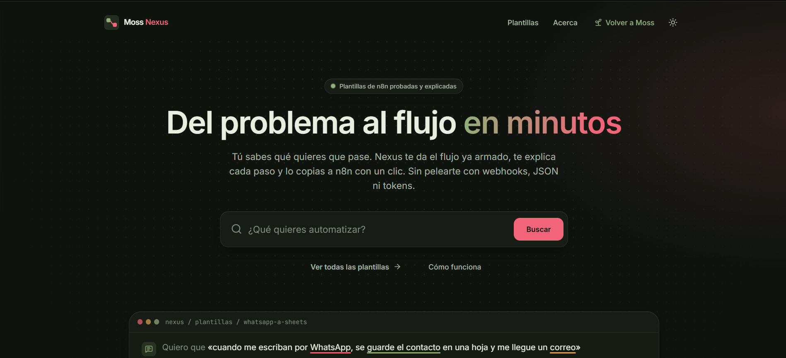
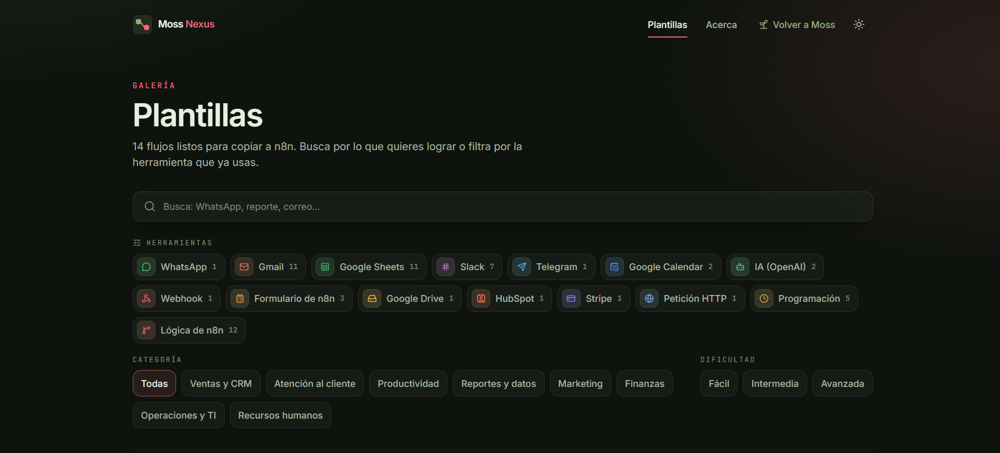
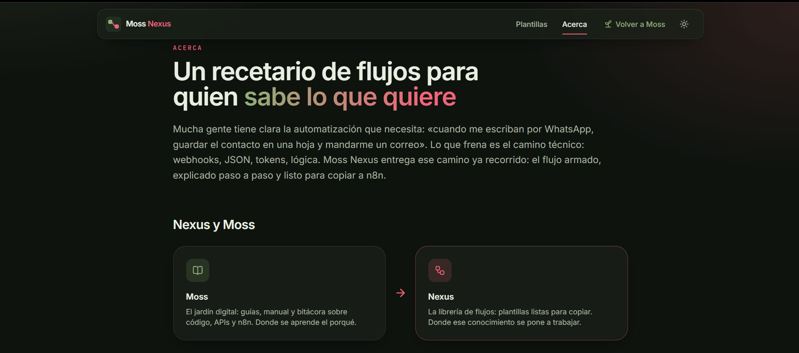
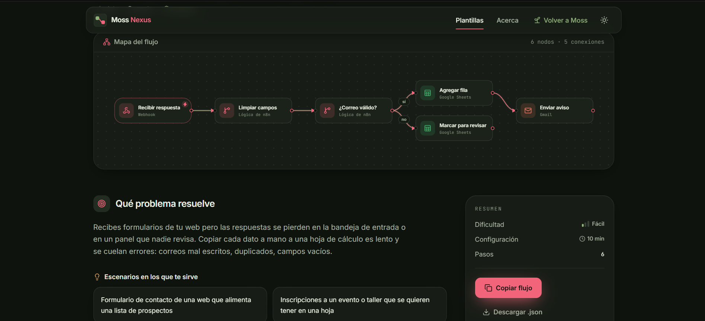

# Moss Nexus

Librería de flujos de automatización para **n8n**, ya armados, explicados y listos para copiar. Está pensada para quien sabe qué quiere automatizar pero no quiere pelearse con webhooks, JSON ni tokens.

**[Ver el sitio en vivo →](https://sergio-velandia.github.io/Moss-Nexus/)** · Proyecto hermano de **[Moss](https://sergio-velandia.github.io/Moss/)**: en Moss se aprende el porqué; en Nexus se copia el flujo y se usa.

## Vista previa

<table>
  <tr>
    <td align="center" width="50%">
      <a href="docs/img/inicio.png"></a>
      <br><sub><b>Inicio</b></sub>
    </td>
    <td align="center" width="50%">
      <a href="docs/img/plantillas.png"></a>
      <br><sub><b>Plantillas</b></sub>
    </td>
  </tr>
  <tr>
    <td align="center" width="50%">
      <a href="docs/img/acerca.png"></a>
      <br><sub><b>Acerca</b></sub>
    </td>
    <td align="center" width="50%">
      <a href="docs/img/ejemplo.png"></a>
      <br><sub><b>Ejemplo</b></sub>
    </td>
  </tr>
</table>

## Estado

| Fase | Estado |
| --- | --- |
| Fase 1: estructura, diseño, galería y detalle | ✅ Completa (v0.1.0) |
| Fase 2: primeros flujos reales | ✅ Completa (v0.2.0): 2 plantillas publicadas, pendientes de probar en n8n |
| Fase 3: plantillas reales para entornos profesionales | ✅ Completa (v0.3.0 a v0.5.0): 14 plantillas en total, pendientes de probar en n8n. Desde aquí, la librería se actualiza con plantillas sueltas |
| Fase Legal: términos, privacidad, contacto y licencia | 🛠️ En curso |

Historial completo en el [CHANGELOG](CHANGELOG.md).

## Desarrollo

```bash
npm install
npm run dev        # http://localhost:5173
npm test           # pruebas (incluye la validación de todas las plantillas)
npm run lint
npm run build      # typecheck + build de producción
```

Cada push a `main` se publica en GitHub Pages (`.github/workflows/deploy.yml`).

## Cómo agregar una plantilla nueva

Agregar una plantilla es **solo crear una carpeta**. No hace falta tocar ningún componente.

1. Crea `src/data/templates/<slug>/` (el slug va en minúsculas, con guiones: `whatsapp-a-sheets`).
2. Pon dentro estos tres archivos:

### `meta.json`

```json
{
  "slug": "whatsapp-a-sheets",
  "titulo": "Contactos de WhatsApp a Google Sheets con aviso por Gmail",
  "resumen": "Una línea: lo que verá la tarjeta de la galería.",
  "problema": "Un párrafo con el problema real que resuelve, sin jerga.",
  "categoria": "ventas",
  "herramientas": ["whatsapp", "google-sheets", "gmail"],
  "dificultad": "facil",
  "tiempoEstimado": 15,
  "requisitos": ["Cuenta de Google", "Credenciales de WhatsApp Business"],
  "escenarios": ["Tienda que atiende pedidos por WhatsApp"],
  "pasos": ["Pulsa «Copiar flujo».", "Pégalo en un flujo nuevo de n8n.", "Conecta tus credenciales.", "Prueba y actívalo."],
  "probado": { "fecha": "2026-10-12", "versionN8n": "1.112.0" },
  "destacado": false
}
```

| Campo | Valores |
| --- | --- |
| `slug` | Igual al nombre de la carpeta |
| `categoria` | Un id de [`src/data/categories.ts`](src/data/categories.ts) |
| `herramientas` | Ids de [`src/data/tools.ts`](src/data/tools.ts), en el orden en que aparecen en el flujo |
| `dificultad` | `facil`, `media` o `avanzada` |
| `tiempoEstimado` | Minutos para configurarla la primera vez |
| `destacado` | `true` para que aparezca en «Destacadas» del Inicio |
| `probado` | Opcional. Solo cuando el flujo se probó en una instancia real de n8n: `{ "fecha": "AAAA-MM-DD", "versionN8n": "1.x.x" }`. Sin él, la plantilla se muestra como «Sin probar» |
| `ejemplo` | Opcional. `true` marca la plantilla como ficticia |

### `diagram.json`

El mapa visual se dibuja solo a partir de esta lista. No hacen falta coordenadas.

```json
{
  "nodos": [
    { "id": "wa", "etiqueta": "Mensaje nuevo", "herramienta": "whatsapp", "tipo": "disparador" },
    { "id": "hoja", "etiqueta": "Guardar contacto", "herramienta": "google-sheets", "tipo": "accion" }
  ],
  "conexiones": [{ "origen": "wa", "destino": "hoja" }]
}
```

- `tipo`: `disparador`, `accion` o `logica`.
- `conexiones[].etiqueta` es opcional y sirve para nombrar ramas (`"sí"` / `"no"`).
- Las etiquetas de más de 21 caracteres se recortan en el mapa, así que conviene que sean cortas.
- Si el flujo tiene más de 5 columnas (pasos en cadena), el mapa se dibuja en vertical también en escritorio.

### `workflow.json`

Es el JSON exportado de n8n, tal cual: en n8n, selecciona todos los nodos, cópialos (`Ctrl + C`) y pégalos en este archivo. Es lo que copia el botón «Copiar flujo». **Antes de guardarlo, quita los datos de tu instancia:** el bloque `credentials` de cada nodo, el contenido de `pinData` y `meta.instanceId`. Las pruebas fallan si alguno queda, porque el repositorio es público. Revisa también que no queden correos ni datos personales en los parámetros.

3. Ejecuta `npm test`. Si algún dato es inválido (una herramienta inexistente, una conexión rota, un slug que no coincide), la prueba dice exactamente qué falla y en qué archivo. En el sitio, una plantilla inválida se omite y no rompe nada.

### ¿Una herramienta o categoría nueva?

Añádela en [`src/data/tools.ts`](src/data/tools.ts) o en [`src/data/categories.ts`](src/data/categories.ts). Las herramientas usan íconos genéricos de Lucide; Nexus no usa logos de marcas.

## Stack

React 19, Vite, TypeScript, Tailwind CSS 4, React Router, Motion, Lucide y Vitest/oxlint. Sin backend: las plantillas viven en el repositorio.

---

Proyecto independiente, sin relación oficial con n8n GmbH.
