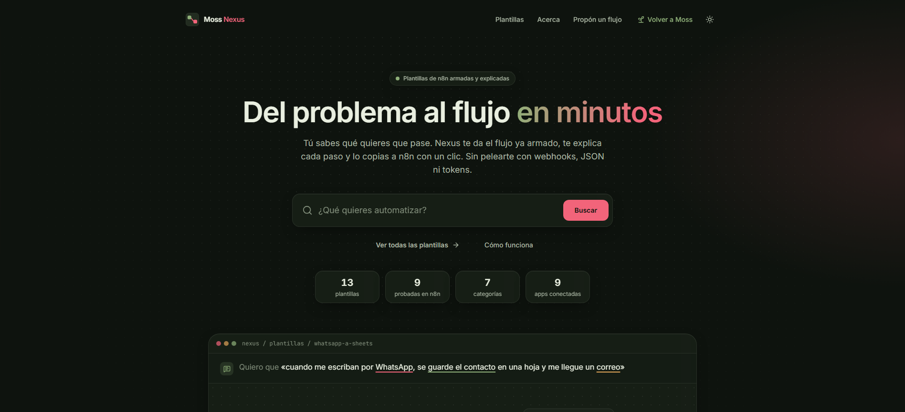
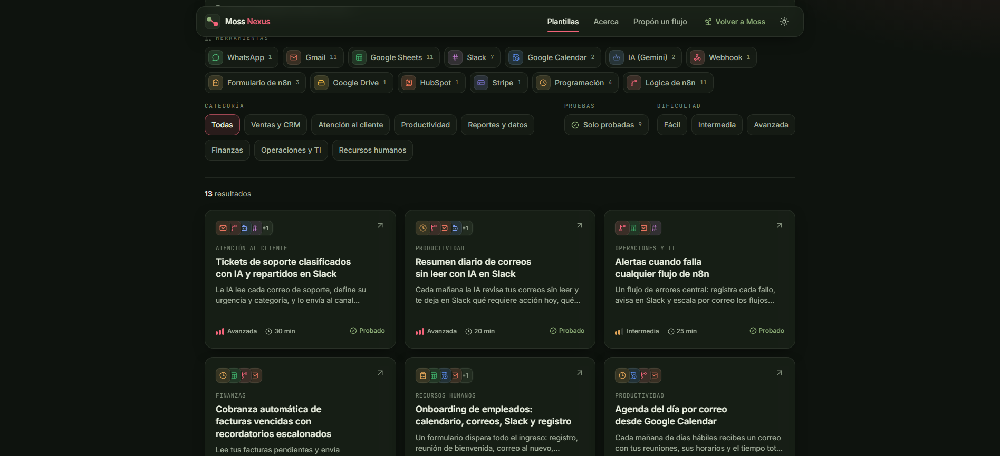
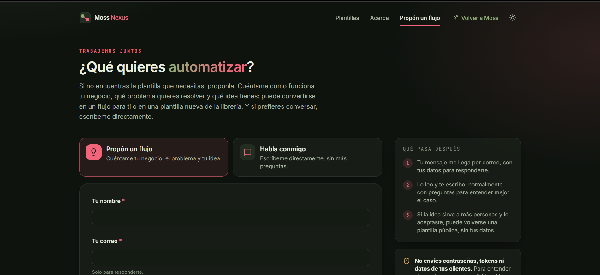
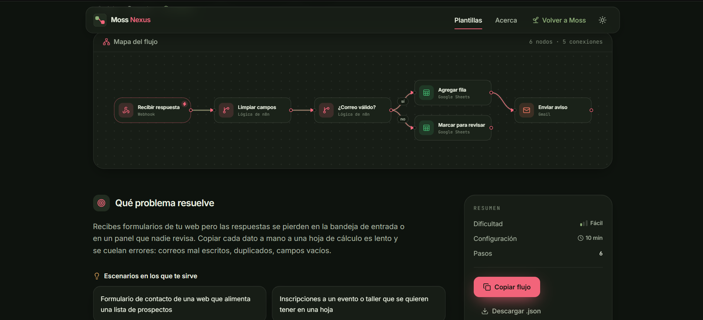

# Moss Nexus

Librería de flujos de automatización para **n8n**, ya armados, explicados y listos para copiar. Está pensada para quien sabe qué quiere automatizar pero no quiere pelearse con webhooks, JSON ni tokens.

**[Ver el sitio en vivo →](https://sergio-velandia.dev/Moss-Nexus/)** · Proyecto hermano de **[Moss](https://sergio-velandia.dev/Moss/)**: en Moss se aprende el porqué; en Nexus se copia el flujo y se usa.

- **[Ver las plantillas](https://sergio-velandia.dev/Moss-Nexus/plantillas/):** cada una dice si ya se probó en una instancia real de n8n.
- **[Primeros pasos](https://sergio-velandia.dev/Moss-Nexus/primeros-pasos/):** monta n8n con Docker e importa tu primera plantilla.
- **[Qué significa el sello «Probado»](https://sergio-velandia.dev/Moss-Nexus/acerca/#sello)** y cómo se prueba cada plantilla.

## Vista previa

<table>
  <tr>
    <td align="center" width="50%">
      <a href="docs/img/inicio.png"></a>
      <br><sub><b>Inicio</b></sub>
    </td>
    <td align="center" width="50%">
      <a href="docs/img/plantillas.png"></a>
      <br><sub><b>Plantillas</b></sub>
    </td>
  </tr>
  <tr>
    <td align="center" width="50%">
      <a href="docs/img/propon.png"></a>
      <br><sub><b>Propón un flujo</b></sub>
    </td>
    <td align="center" width="50%">
      <a href="docs/img/ejemplo.png"></a>
      <br><sub><b>Ejemplo</b></sub>
    </td>
  </tr>
</table>

## Estado

Estable. Lo publicado está en el [CHANGELOG](CHANGELOG.md) y lo pendiente, en el [ROADMAP](ROADMAP.md).

## Cómo contribuir

¿Te falta un flujo, encontraste un error o quieres aportar una plantilla? Mira [CONTRIBUTING.md](CONTRIBUTING.md).

## Desarrollo

```bash
npm install
npm run dev        # http://localhost:5173
npm test
npm run lint
npm run build      # typecheck + build de producción
```

En Windows, si PowerShell bloquea `npm` porque la ejecución de scripts está deshabilitada, usa `npm.cmd`, por ejemplo `npm.cmd run dev`.

Cada push a `main` se publica en GitHub Pages (`.github/workflows/deploy.yml`).

## Stack

React, Vite, TypeScript, Tailwind CSS, React Router, Motion, Lucide y Vitest/oxlint. Sin backend: las plantillas viven en el repositorio y el formulario «Propón un flujo» envía los mensajes con EmailJS. Se publica en GitHub Pages con una página estática por ruta y `sitemap.xml`.

## Licencia

El proyecto usa tres licencias, según el tipo de material:

| Material | Licencia | Qué permite |
| --- | --- | --- |
| Flujos de n8n (`src/data/templates/*/workflow.json`) | [MIT-0](LICENSE-WORKFLOWS) | Copiarlos, modificarlos y usarlos, también con fines comerciales, sin ninguna condición |
| Textos y diagramas de las plantillas (`meta.json`, `diagram.json`) | [CC BY 4.0](LICENSE-CONTENT) | Reutilizarlos y adaptarlos citando a Moss Nexus como fuente |
| Código del sitio (todo lo demás) | [MIT](LICENSE) | Uso libre, conservando el aviso de copyright |

---

Proyecto independiente, sin relación oficial con n8n GmbH.
